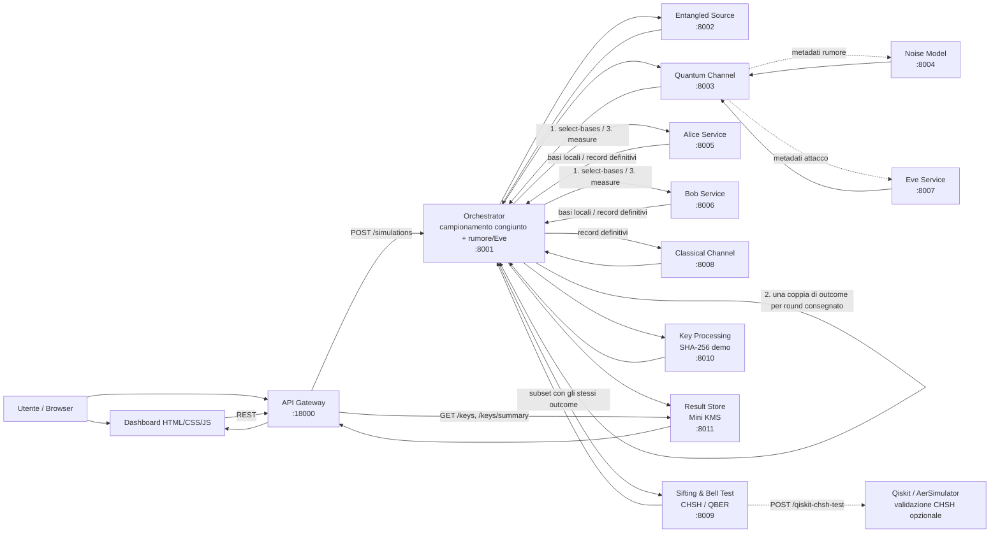
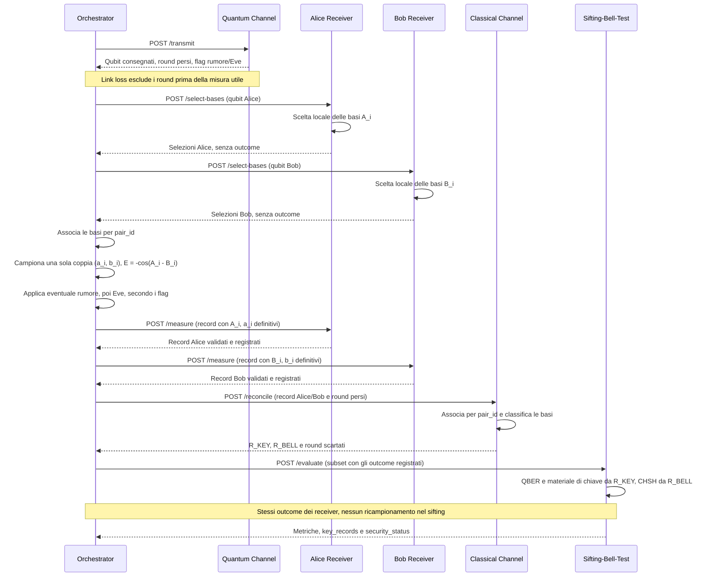

# Figura Architetturale - E91 QKD Microservices

Questo file contiene una proposta di figura architetturale pulita da usare nella tesi. Il diagramma evidenzia il ruolo dell'API Gateway, dell'Orchestrator, dei microservizi di dominio, del Mini KMS e della dashboard.

## Titolo Suggerito

**Figura 4.x - Architettura a microservizi del simulatore E91 QKD.**

## Diagramma Mermaid

## Diagramma di sequenza della misura e del sifting

Le chiamate REST trasportano liste di round; gli indici `i` indicano un singolo
round consegnato. Il campionamento è centralizzato nell'Orchestrator.

`R_KEY` corrisponde a `key_subset`; `R_BELL` a `bell_subset` (alias
`check_subset`). La separazione dei subset avviene nel Classical Channel;
il Sifting-Bell-Test li utilizza per le metriche. `/measure` registra nei record
della risposta gli outcome già campionati: non introduce persistenza durevole.
La scelta delle basi resta locale ai receiver, ma non implica località fisica o
sicurezza device-independent. Qiskit resta una verifica opzionale separata.

## Descrizione Del Flusso

L'utente può interagire con il sistema tramite la dashboard oppure tramite chiamate dirette all'API Gateway. L'API Gateway rappresenta il punto unico di accesso pubblico e inoltra le richieste di simulazione all'Orchestrator.

L'Orchestrator coordina la pipeline E91. Prima richiede la generazione delle coppie entangled, poi invoca il canale quantistico, che applica il modello di attenuazione dei link e propaga i metadati di rumore ed Eve. Per le coppie consegnate, Alice e Bob scelgono separatamente le basi con `/select-bases`. L'Orchestrator campiona congiuntamente gli outcome una sola volta, applica rumore/Eve e li invia ai receiver tramite `/measure` per registrarli nei record definitivi. Il Classical Channel effettua il sifting, separando key subset, Bell subset e round scartati.

Il servizio Sifting & Bell Test calcola CHSH, `abs_chsh`, QBER e `security_status` usando gli stessi outcome registrati, senza ricampionamento. Qiskit/AerSimulator rimane confinato a un endpoint opzionale di validazione circuitale della componente CHSH. Il servizio Key Processing genera la chiave finale dimostrativa solo quando la sessione è sicura e il materiale sifted raggiunge la soglia minima. Il Result Store salva il risultato completo e un record sintetico nel Mini KMS, usato dalla dashboard per visualizzare storico e statistiche.

## Componenti Da Includere Nella Figura

- Client: utente, dashboard statica e API Gateway.
- Coordinamento e campionamento congiunto: Orchestrator.
- Sorgente e canale: Entangled Source, Quantum Channel, Link Loss, Noise Model, Eve Service.
- Misura e sifting: Alice Service, Bob Service, Classical Channel.
- Valutazione: Sifting & Bell Test, CHSH, QBER, Qiskit/AerSimulator opzionale.
- Chiave e persistenza: Key Processing, Result Store, Mini KMS.
- Flussi dati principali: `POST /simulations`, chiamate REST interne, `GET /keys`, `GET /keys/summary`.

## Didascalia Suggerita

**Figura 4.x - Architettura a microservizi del simulatore E91 QKD.** La figura mostra il flusso end-to-end della simulazione: l'API Gateway riceve la richiesta, l'Orchestrator coordina i servizi di generazione, trasmissione, misura, sifting, Bell test e key-processing, con scelta locale delle basi, campionamento congiunto centralizzato e registrazione degli outcome nei receiver prima del post-processing; il Result Store conserva risultati e key record nel Mini KMS. Qiskit/AerSimulator è usato solo come validazione circuitale opzionale della componente CHSH.
